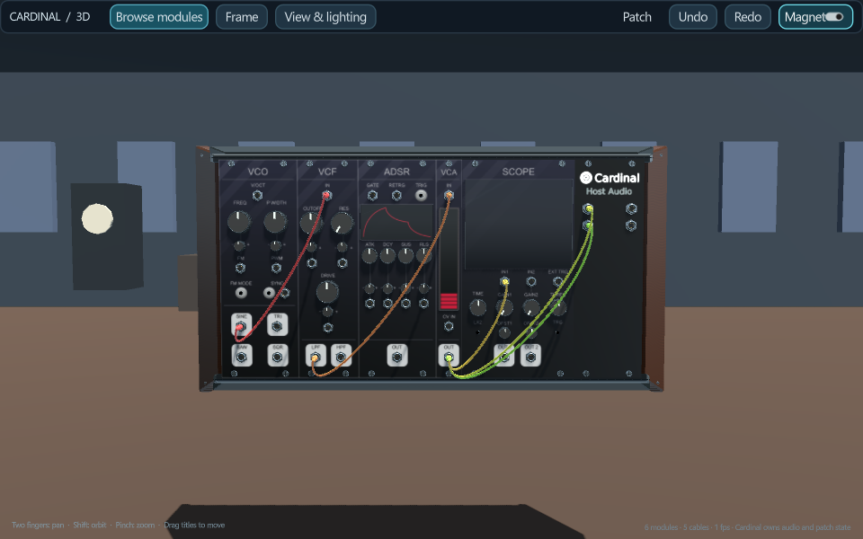

# Cardinal 3D Live · v0.5 alpha

Build a modular instrument, perform inside it, and invite an audience into the same 3D world.

Cardinal 3D Live embeds DISTRHO Cardinal's synthesis engine in a Windows desktop/Quest Link performer. Musical signals drive spatial speakers, lights, fountains, particles, figures and kinetic sculptures. Visitors join from desktop browsers, phones, tablets or WebXR headsets, with spatial sound, avatars, reactions and shared chat.

**[Download v0.5 alpha](https://github.com/mtyas/Cardinal-3D-Live/releases/tag/v0.5) · [User guide](docs/LIVE-MANUAL.md) · [Pipelines](docs/PIPELINES.md) · [Hosting](docs/HOSTING.md) · [Build locally](docs/BUILD-LIVE.md)**

## Quick start

Extract the entire Windows release ZIP and keep its folders together.

1. Run **1 - Start Show server.bat** and leave its window open.
2. Run **2 - Performer desktop.bat**. For VR, first enter USB Quest Link through Meta Horizon Link, then use **2 - Performer Quest.bat** instead.
3. Choose your audio input/output, channels, sample rate and buffer in Audio & MIDI.
4. Open the visitor address printed by the server, choose a name and enter. Enable spatial sound to listen.

The portable download includes Godot, native engine/module resources, Node.js and web dependencies. Python, Docker and compilation are not needed to play locally. Internet hosting needs configuration. Start at low volume: the factory patch produces a tone.

## Perform and attend

- More than 1,400 module models, original panels, native undo and recovery.
- Desktop arrows walk/strafe; Shift + Up/Down changes height. Middle-button drag looks around; wheel zooms. The toolbar wraps on narrow windows.
- Quest: trigger + wrist adjusts controls; grip gives fine adjustment. A opens modules, B the main menu, grip + B the selected module's context menu. Sticks pan/zoom; grip + stick changes height/heading.
- Multiple cases share one patch. Layout mode unlocks placement; performance mode locks it.
- Hardware capture reaches Audio 2's output sockets. WASAPI, ASIO and DirectSound controls include devices, channels, sample rate and buffer. MIDI is separate from environments.
- Show Speaker, Light, Figure, Fountain, Particles, Sculpture and Chat Board modules expose musical/CV controls, including clock/reset where relevant.
- Visitors have no synth-edit privileges. Phones/tablets use a discreet stick and drag-to-look. Data saving defaults to 64 kb/s per mono source and fewer scene updates.
- Visitor VR includes a movable HUD, virtual keyboard, sound activation and quality selection. Browsers spatialize each source locally using HRTF panners. A worker decoder supports compressed audio without native Opus decoding.

## Hosting

The Windows PC runs the performer and audio relay. An optional always-on Umbrel welcome service keeps the homepage and latest performance list available while the PC is off, then forwards live traffic over a private backhaul during a show. HTTPS/WSS proxying and Telegram announcements are configurable.

Public defaults are generic. Configure your own hostname, profile, dates and announcement channel. Private tokens, machine settings, event history and patches are excluded from the release.

## Alpha limits

Windows x64 and Quest 2 through USB Quest Link are the primary performer targets. Binaries are unsigned. Browser/device testing remains necessary. Audio uses Opus over WebSockets; WebRTC/SFU, TURN, imported animated assets, moderation and sustained 100-listener certification remain future work.

## Licences and sources

Project code is **GPL-3.0-or-later**, without warranty. Built on [DISTRHO Cardinal](https://github.com/DISTRHO/Cardinal), VCV Rack, Godot and all included module authors' work. This is an independent modified host.

Artwork/fonts/samples retain separate terms, including noncommercial/custom licences. Read [NOTICE](legal/NOTICE.txt), [Cardinal's licence table](legal/LICENSES.md), [artwork permissions](legal/LICENSE-PERMISSIONS.md), [Godot notices](legal/Godot-COPYRIGHT.txt) and [web notices](show-web/THIRD-PARTY-LICENSES.txt). They accompany the download and are available inside the performer.

Each binary release has a **complete matching source archive** including recursive Cardinal modules, bindings, SDK and dependency sources. GitHub's automatic source ZIP alone is incomplete. See [release notes/provenance](docs/RELEASE-0.5.md).

Created by [mtyas](https://github.com/mtyas), building on Cardinal 3D. [Cardinal 3D v0.77](https://github.com/mtyas/Cardinal-3D/releases/tag/v0.77) remains a separate project.
