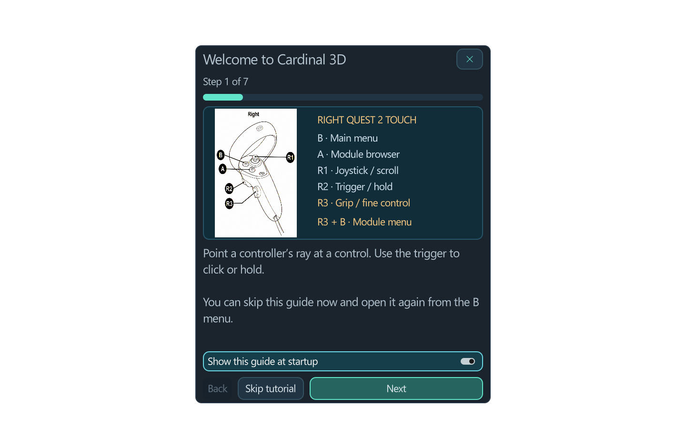

# Cardinal 3D Live · user guide

Extract the whole release. Start the Show server, then choose one performer launcher. Quest requires an active Meta Horizon Link/USB Quest Link session. Start at low volume.

## Desktop

The wrapping toolbar separates modules, audio, environment and broadcasting. Patch contains load/save, examples and undo/redo. Frame rack returns to the instrument.

| Action | Control |
| --- | --- |
| Walk forward/back | Up/Down arrows |
| Strafe | Left/Right arrows |
| Rise/lower | Shift + Up/Down |
| Look | Middle-button drag |
| Pan | Shift + middle-button drag |
| Zoom | Wheel |
| Move module | Drag title strip |
| Module options | Right-click |

Arrow movement pauses during typing, module browsing and settings. The shared performer avatar follows the desktop camera.

## Quest performer

Trigger + wrist adjusts knobs/faders; grip adds fine control. A opens modules, B the main menu, grip + B the selected module's context menu. Sticks pan/zoom; grip + stick changes height/heading. Sticks scroll lists. Use title strips to move modules and socket interactions to connect/repatch/unplug cables.

## Patch, devices and world

Select input/output driver, device, channel ranges, sample rate and buffer in Audio & MIDI. Audio 2's output sockets carry captured input. MIDI controls are separate from environments. Speaker-only monitoring requires sound connected to Show Speaker inputs.

Multiple cases share one patch. Layout mode unlocks case creation/deletion/placement; leave it to lock the instrument. Save `.vcv` and `.vcv.3d.json` together. Environment/time-of-day/rendering controls have their own page.

Show Speaker, Light, Figure, Fountain, Particles, Sculpture and Chat Board modules turn audio/CV into spatial sound and visual objects. Their clock/reset inputs synchronize animation. Chat Board controls its size, font, colours and position. Point at it in performer VR to write using virtual or physical keyboards.

## Audience

Start broadcasting in Show & broadcast. Private rehearsals use copied invitations. Public show allows entry from the homepage and optionally triggers Telegram announcements.

Desktop visitors use WASD/arrows and drag-to-look. Phone/tablet visitors use a faint bottom-left joystick and can look with a second finger. Chat & sound opens settings. Data saving is enabled by default; quality remains selectable.

Visitor VR: B/Y toggles the HUD; grip + B/Y recalls it. Trigger-hold its title to move/rotate, use the stick for distance, release to place. Write a message opens the keyboard. Sound and quality are available directly in the panel.

## Finish

Stop broadcasting, wait about ten seconds for history to update, save your patch, then close the performer and PC server. The welcome service can remain online. History logs dates/duration, not audio/video recordings.

[Hosting](HOSTING.md) · [Pipelines](PIPELINES.md) · [Licences](../legal/NOTICE.txt)
