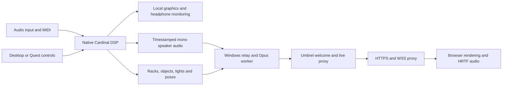
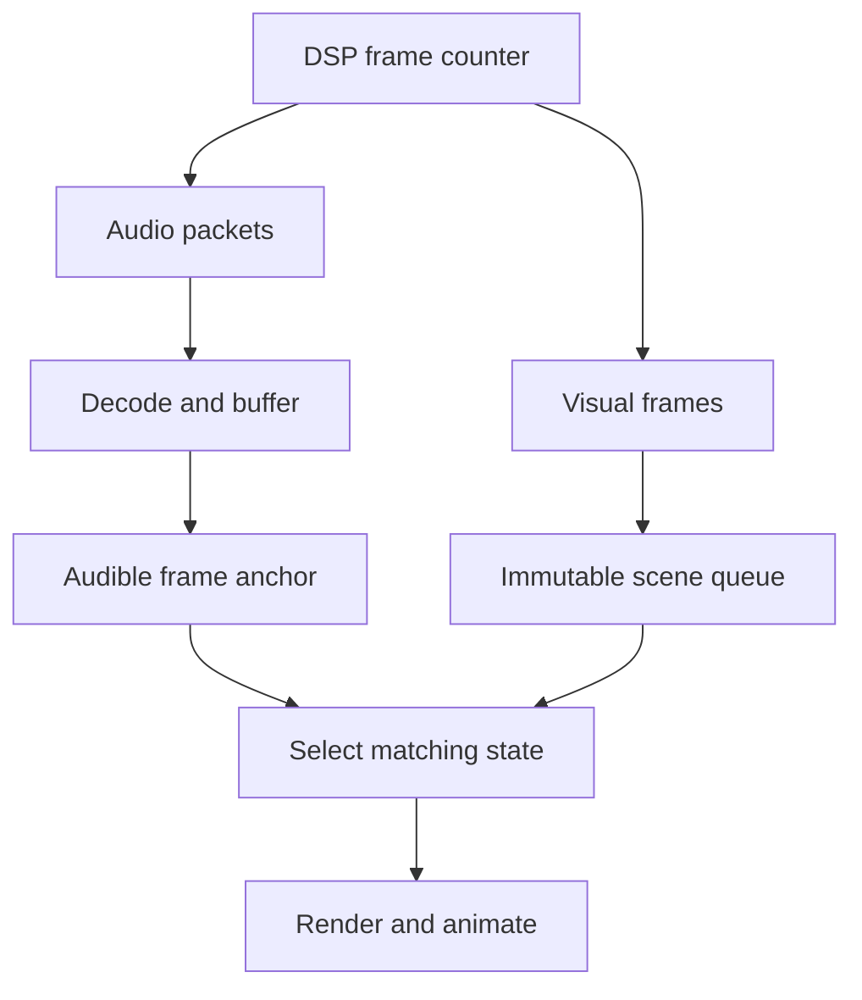

# How the pipelines work

## Roles

The Godot Windows performer contains a native Cardinal engine extension. It owns the patch, devices, MIDI, control interactions and local rendering. The separate Node relay on the performance PC owns room membership, chat, audio encoding and distribution. An optional Umbrel welcome service handles the persistent homepage and announcements. Visitors render and spatialize sources locally.

Local rehearsals connect directly to the relay. Public hosting uses HTTPS/WSS. The native performer publishes locally with an ephemeral host key; the public proxy cannot grant host privileges.

## Hardware and synthesis

The selected Windows backend captures the chosen input channels. Native host buffers expose these samples through Audio 2's output sockets. Cardinal processes the patch at the configured sample rate and block size. The Host Audio capture cursor advances correctly in input-only patches.

Show Speaker modules provide distinct audio taps and spatial parameters. Optional speaker-only local monitoring mixes them for the performer's head/camera position, replacing the ordinary dry stereo output. Local callbacks do not wait for visitors. Device restarts preserve desktop/VR mode and patch recovery.

## Audience audio

The engine writes PCM to bounded source rings with DSP frame timestamps. A Godot networking thread drains them. The relay validates the blocks and passes them to a Node encoding worker, which resamples to 48 kHz and emits 20 ms Opus packets at 64/96/128 kb/s per mono source, subject to the performer ceiling.

Visitors receive audio only after enabling it. Native WebCodecs or a bundled WebAssembly worker decodes each mono source. An AudioWorklet buffers playback; separate HRTF panners position sources for each visitor. The stream is not a single fixed stereo mix.

Normal audience buffering is approximately 180 ms, or 300 ms with mobile data saving, plus transport/device latency. Late packets can reanchor after a radio interruption. Queues remain bounded. Local performer monitoring is independent of audience buffering.

## Visuals and synchronization

Godot captures cases, panels, controls, cables, speaker/light/object parameters, environment/time and head/hands. Artwork and scenery are uploaded once and served by content hash. The relay validates numeric bounds and object counts.

Visitors receive a full initial snapshot, then immutable changed-value patches. Mobile data saving reduces updates to about 10 Hz. Missing baselines request a full resync; text compression reduces traffic further. Local interpolation/animation continues between updates.

The visual queue uses DSP frames. AudioWorklet playback anchors identify the audible frame, so lights, objects and controls follow buffered sound instead of displaying only the newest packet.

## Chat, visitors and persistence

The relay accepts bounded identity, pose, reaction and chat messages. Visitors cannot claim performer status or edit the synth. Chat boards, desktop chat and the movable VR HUD share one channel. The virtual keyboard uses the same message path as physical typing. Reactions have server-enforced cooldowns.

The welcome service saves a public profile/history snapshot in its own volume and polls live status. With the PC off it serves the homepage and latest completed-show information. Live room assets and visitor sockets are forwarded to the PC when available.

Only public sessions receive durable performance-history IDs. Telegram automation uses these IDs to post once per public performance. Confirmed sends survive service restarts; rate limits may retry, while ambiguous deliveries are not repeated automatically. Secrets stay in private storage and are not part of public APIs.

The alpha uses WebSocket audio distribution, not an SFU. Room ceilings are not measured audience guarantees; production-scale testing and moderation remain future work.
