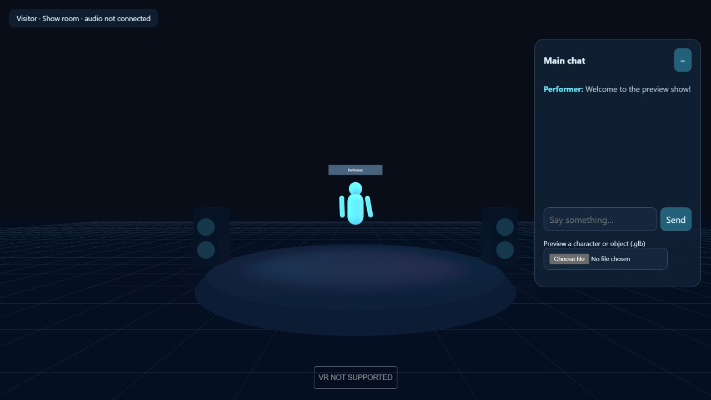
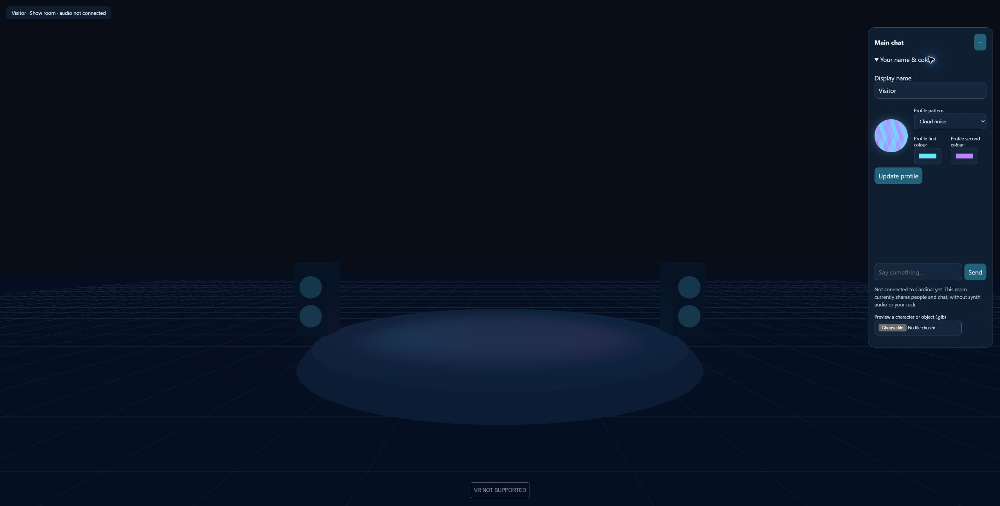
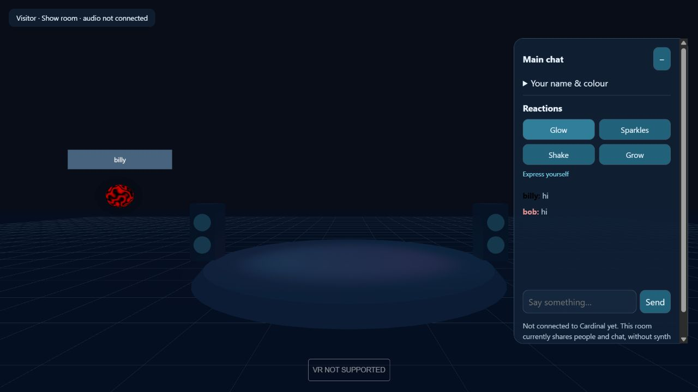
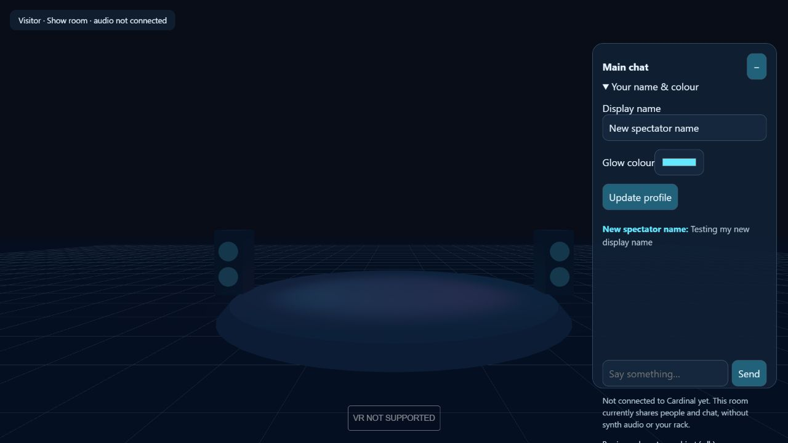
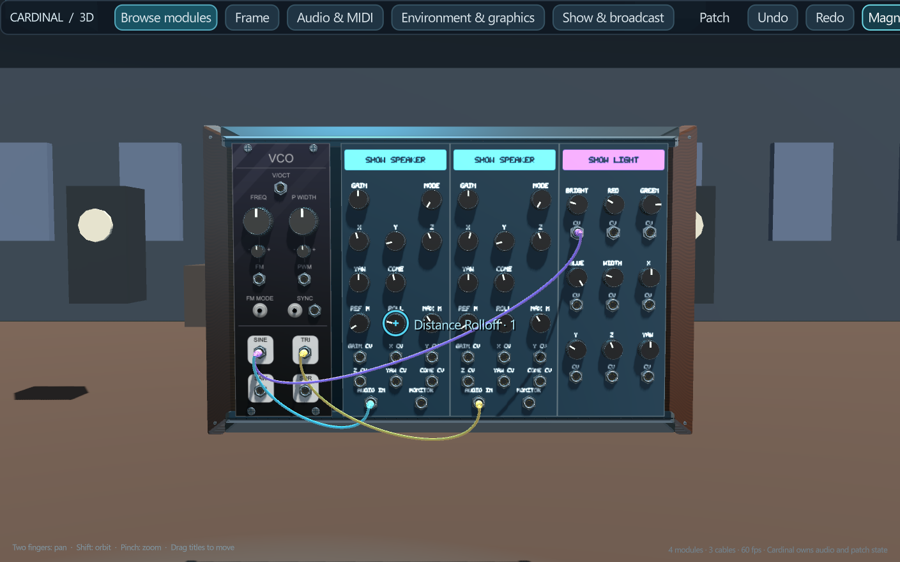
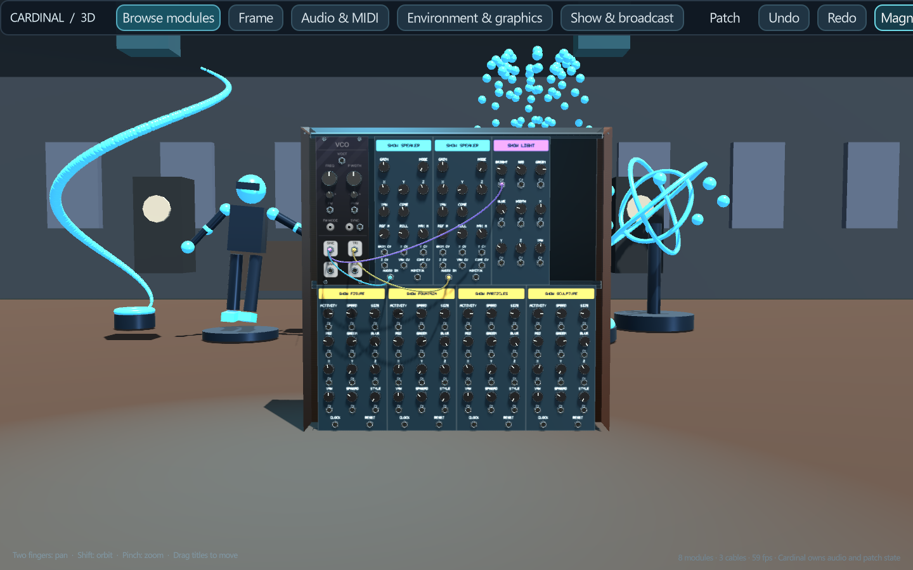

> Historical development reference. For Live v0.5, start with [the current manual](LIVE-MANUAL.md), [hosting](HOSTING.md) and [pipelines](PIPELINES.md).

# Show mode · next-version development

The performer runs the Windows standalone application with Quest Link. Audience members join a **3D WebXR website**, using either a normal browser or a compatible VR browser. The performer alone controls the synth. Visitors appear as coloured glowing lights with names above them. The performer has an animated character. Everyone has a shared main chat panel at the side.

## Working now

`show-web` is a separate, local development preview. It does not change the v0.77 application or your saved patches.

- A 3D room with a stage, speaker placeholders and lighting.
- Desktop walking and looking; a WebXR entry button on compatible browsers.
- Shared participant positions, names and custom colours, with interpolated movement.
- A distinct performer role, one performer per room, and an animated procedural humanoid with a visor, contrasting suit, hands and boots.
- Shared main chat, bounded history, escaped text rendering and message rate limits.
- Shared visitor reactions: Glow, Sparkles, Shake and Grow. Effects last 3.2 seconds, with a 3.5-second cooldown enforced by the server. Buttons appear in the desktop and immersive side panels. Reactions affect the visitor's appearance, not their position or viewpoint.
- An immersive side chat panel, controller rays and three quick replies. Full VR text entry is still pending.
- Audience clients provide navigation, appearance choices and chat. Object/character import is reserved for the performer in the Windows Cardinal application and is not yet implemented.

### Try the preview

Open **Launch Show web preview.bat** in the workspace folder. Node.js must be installed. The launcher installs the pinned dependencies once, then starts a server on this PC only.

The window displays two addresses: a visitor address and a private performer preview address. Open them in separate browser windows to test presence and chat. WASD/arrows move; drag the background to look. In immersive VR, the stick moves and grip + stick raises/lowers or turns your view. Normal desktop browsers can display “VR NOT SUPPORTED”; desktop navigation still works.

Choose your name and glow colour before entering. Inside the room, expand **Your name & colour** to change them. The browser remembers your choice for the next visit. Changes apply to your overhead label and new chat messages; earlier messages retain the name they were sent with.

Visitors can choose Solid, Soft gradient, Cloud noise or Marbled glow, with two colour pickers and a round preview. Their appearance is shared with the room and remembered by the browser. Pattern textures are generated only when the style changes.

Use the server address (normally `http://localhost:8778`), rather than opening `index.html` directly. Opening the HTML from disk now shows launcher instructions. Loading and joining failures display an explanation instead of an indefinite connecting message.

The **Reactions** buttons provide temporary applause in light: brighter glow, coloured sparkles, a small shake or an enlarged visitor light. The effect is visible to the other people in the room and automatically fades back to normal. In VR, point at a reaction on the side panel and pull the trigger.

If the launcher says the room is already running, use the existing room; it now reopens the visitor address instead of starting another server. The original server window contains the private performer address. An unrelated service using the same port produces a clear error instead of a crash.

This localhost server is **not an internet hosting service**. A Quest browser on another device needs an HTTPS deployment, authentication and secure WebSocket access; that deployment is not configured yet. Closing the server window ends the session. No microphone/camera permission is requested.

## Native local test now working

**Launch Show performer test.bat** uses an isolated Show runtime and `show-user`
recovery directory. Its first launch has a VCO connected to two **Show Speaker**
modules and a **Show Light** brightness CV input. In the browser, join the room
and choose **Enable spatial sound**. Walk to hear each source from your position.

The performer menu **Show & broadcast** adds modules and starts/stops publishing.
Speaker gain, XYZ/yaw, omni/directional cone and distance controls save in the
normal patch. Light CV controls brightness, RGB, width, XYZ offsets and yaw.
Networking and scene updates stay outside the DSP callback. A dedicated Godot worker owns the publishing socket and drains shared audio rings independently of module previews. Worker shutdown completes before native engine destruction.

Current local transport uses **Opus** at 64 / 96 / 128 kb/s per mono source in browsers with WebCodecs Opus decoding. The relay encodes each source once per quality in a separate worker; the visitor chooses a quality up to the performer's ceiling. Automatic selects 96 kb/s, reducing to 64 kb/s under relay queue pressure. A PCM compatibility path remains for browsers without Opus decoding.

Separate HRTF panners and a ~180 ms audience buffer preserve spatial sources. Lighting follows the audible sample clock, including conversion between native DSP and 48 kHz Opus timelines. Network buffering is independent of local performance latency.

Confirmed checks: source isolation and timestamps, CV brightness, patch
roundtrip, real Godot-to-visitor audio/light delivery, queue bounds, resampling
and existing graphics/audio/control regressions. Browser UI and subjective
listening await manual checks because browser automation was blocked.

Latest measured fibre: **900 Mb/s upload and download**. Four 64 kb/s mono
sources for 100 listeners would total **25.6 Mb/s before overhead** at the 64 kb/s setting. This estimate excludes protocol overhead; 100-listener capacity still requires load and internet tests.

## Native Show mode implementation

The native synth remains the authoritative engine, with one DSP clock. Local rendering and network streaming must never create extra engine steps or wait for a slow visitor.

### Show Speaker module

Add a project-owned native plugin module, repeatable in the patch. Mono audio input initially, gain/mute controls, a stable source ID, and a corresponding placeable 3D speaker. Omni and directional modes are scene properties; directional speakers have adjustable cone width and off-axis attenuation.

Each DSP module writes to a preallocated source ring. Godot's audio consumers read individual sources independently while the existing engine owner advances the patch once. A source disappears safely when its module is deleted; playback must retain a stable source handle until it stops. No allocations, network calls or scene traversal in the DSP callback.

The spatial menu exposes reference distance, maximum distance, rolloff model/amount, master gain and directional cone settings. Headphones need binaural rendering; simple stereo panning must not be presented as full HRTF. Compare the Godot renderer with an HRTF-capable implementation before selecting the local path.

### Show Light module

A repeatable native module with brightness, R/G/B, beam width, X/Y/Z offset and orientation CV inputs. Define unipolar colour/brightness inputs as 0–10 V, spatial offset/orientation as bipolar with configurable ranges. Publish bounded control state through atomics; consume at the rendering cadence, independently of panel-image updates. Smooth controls enough to avoid flicker while preserving intentional sequenced changes. Let the user choose spot/omni fixtures, base placement and whether CV is absolute or relative. Limit shadow-casting fixtures separately from total fixture count.

### Placement, scenery and saves

Use an explicit **Show edit** mode for moving speakers, lights, props and characters. Lock editing during a performance. Maintain independent stable object IDs and module links. Store transforms, imported asset references, animation choices and audio settings in a versioned show sidecar alongside the patch and rack-layout data. Save/load/new-patch actions must treat these together; recovery must never overwrite a previously saved show.

Only the performer imports objects and characters in Cardinal 3D. Visitors receive the resulting scene; they cannot upload, add or move show assets. Use self-contained GLB for the first import format, including textures and skeletal animation. Copy assets into a show asset directory and reference them by content hash so visitors receive exactly the same asset. Provide scale, position, rotation, animation selection, loop and speed; later expose animation controls to CV. A user-provided performer avatar can use its embedded idle/dance clips, then headset/controller tracking when a compatible skeleton is available.

## Shared shows

The current prototype also receives native per-source Opus/PCM audio and CV light state on the local PC. The production transport still needs:

1. A Windows host connection that publishes the actual show scene, rack visual state, performer pose and CV light state. Visitors must never execute synth-edit operations.
2. WebRTC audio **per spatial source**, encoded away from the native DSP callback. Each browser decodes each source and positions it around that visitor with a Web Audio HRTF panner. A single mixed stereo stream cannot reproduce separate source positions as visitors walk.
3. A shared timing model for source audio, CV lights and avatar motion. Network jitter buffering is separate from local performance latency; a slow browser cannot delay the performer.
4. HTTPS/WSS hosting, room join credentials, TURN connectivity, asset distribution and reconnect handling. Internet audience limits depend on the transport/bandwidth budget; source and audience counts need measured limits before public deployment.
5. Performer tools to mute/remove disruptive participants, moderate chat and lock room access. Audience glow colour/name edits remain visitor-owned; scene, synth and show controls remain performer-owned.

The host preview address currently creates a browser placeholder performer. It does **not** connect to the Windows Cardinal process. Procedural arm motion is a visual placeholder, not captured performer tracking. Native Show speakers emit separate spatial audio sources; the static preview props remain decorative.

## Acceptance checks before release

- Two native speakers playing independent patch signals: head motion, translation, directionality, mute, deletion/recreation and save/reload.
- CV lights sequenced against audio without relying on panel texture refresh; no regression in knob response or audio underruns.
- Import, animate, save and reopen a character/prop; missing assets recover with an understandable message.
- Quest browser join over HTTPS: controller navigation, names, chat legibility and actual spatial audio.
- One Windows performer plus two independent browser visitors: different listener positions, reconnect, host disconnect, source removal, chat moderation and visitor rejection of host-only commands.
- Measure CPU/GPU/audio latency in the local standalone independently of streamed audience latency.

Technical references: [Three.js WebXR](https://threejs.org/manual/pages/webxr-basics.html), [Godot 4.5 AudioStreamPlayer3D](https://docs.godotengine.org/en/4.5/classes/class_audiostreamplayer3d.html), [Godot runtime asset loading](https://docs.godotengine.org/en/stable/tutorials/io/runtime_file_loading_and_saving.html).

## Audio input and hardware settings

In the performer main menu, open Audio & MIDI. Choose Godot's Windows output or the direct WASAPI, ASIO or DirectSound backend. Direct audio exposes input/output interface, physical left/right channel assignments, sample rate and requested buffer size. Input may be disabled entirely or per channel. The Host Audio module's output sockets deliver the captured input to your patch; its input sockets receive your patch's output. This host currently routes two patch input and two monitor output channels, chosen from all channels exposed by the interface. Show Speaker streams remain independent.

Apply saves patch recovery and restarts the app. Unsupported devices fall back to Godot output with an error in the log. The status shows actual driver buffer size, input peak and dropout count. ASIO requires the same interface for input and output. The Open active ASIO driver control panel button exposes the interface driver's own buffer and hardware settings. Driver requests may be negotiated: the RME ASIO test requested 256 and obtained 512 samples. Device lists are cached; choose Rescan interfaces & restart after adding hardware. The first scan may take a minute if disconnected ASIO drivers are registered.

Verified: Host Audio input reaches a Show Speaker without mixing the other input, WASAPI output advances the real engine, RME ASIO exposes 32 inputs/34 outputs and opens selected physical channels, invalid-device cleanup, and Opus decoding/resampling/quality ceilings through a real relay. Microphone/interface listening and browser Opus playback need manual confirmation.

## Desktop and Quest test launchers

The desktop toolbar has separate Audio & MIDI, Environment & graphics and Show & broadcast buttons. Each selects its own page regardless of the last menu used. Audio interface scanning begins when the audio page is shown, rather than while opening the module browser.

For the performer in Quest Link, connect the USB PC VR session and run **Launch Show performer Quest.bat** from the workspace. Its equivalent is `python scripts/run_embedded_windows.py --show --vr`. The ordinary Show performer test launcher deliberately opens the desktop view. Both use Show recovery/settings; v0.77 remains separate. The visitor's standalone Quest browser is a different path requiring a reachable HTTPS/WebXR room; localhost on the headset addresses the headset, not the Windows PC.

Continuity check: a real native performer published two Opus sources while its main thread was blocked for 700 ms and its module browser opened. The listener observed a maximum packet gap of 35 ms and no native speaker ring overflow. Physical headset behavior still requires a Quest Link test.

## Live rack and scenery sharing

Start the web preview, then launch the Show performer (desktop or Quest Link). Start broadcasting in **Show & broadcast** if it is not already live. Reload the visitor page and enable spatial sound. The visitor receives the real module panel artwork, live knobs/sliders/LEDs, cables, and the positions of separate rack cases. The same procedural scenery geometry is shared from the performer, including the selected time of day. Desktop racks are presented at standing height on the stage; Quest racks retain their world positions.

Panel artwork is sent once per module on connection; control and light states travel separately. Special animated panel displays are not yet streamed. Imported scenery/characters remain future work. An invitation-protected HTTPS internet pilot is now available. The local preview currently shares up to 128 modules, 32 cases and 512 cables. The performer avatar has idle animation; Quest head position and heading are shared, but arms are not yet tracked individually.

### Show Speaker controls

| Label | Meaning |
|---|---|
| GAIN | Audio level, 0–2×. Gain CV multiplies it by 0–1 with 0–10 V. |
| X / Y / Z | Speaker position in metres. Each position CV adds 1 metre per volt. Y is height. |
| YAW | Horizontal direction, in degrees. CV adds 18 degrees per volt. |
| MODE | Omnidirectional or directional emission. |
| CONE | Directional beam width. CV adds 15 degrees per volt. |
| REF M | Distance where attenuation starts, in metres. |
| ROLL | Strength of distance attenuation. |
| MAX M | Maximum attenuation distance, in metres. |
| AUDIO IN | Mono signal sent to the visitor. |
| MONITOR | Local audio passthrough after gain. |

### Show Light controls

BRIGHT controls intensity; RED, GREEN and BLUE set the colour. WIDTH sets the cone angle. X/Y/Z position the light in metres; YAW turns it horizontally. Each has its own labelled CV socket. Brightness and colour CV use 0–10 V; width CV maps 0–10 V to 5–160 degrees. Position CV adds 1 metre per volt; direction CV adds 18 degrees per volt.

Lights now have a visible metal fixture, mounting yoke and coloured lens, so they remain findable even when their brightness is zero. **Light fixture aiming guides** in Show & broadcast toggles the performer’s guide rays.

The native integration test fetches real PNG panel and JSON scenery assets and decodes the two mono Opus streams while the module browser opens. Speaker CV gain, position and direction are verified through the real DSP input graph. These automated checks do not replace a browser/Quest visual review.

## Four visual instrument modules

Add **Show Figure**, **Show Fountain**, **Show Particles** or **Show Sculpture** from the module browser or Show & broadcast. Each module creates a separate object in the performer and visitor space. Add as many as the GPU budget permits; the relay currently caps visual objects at 64.

- Figure: an articulated dancing robot with a coloured head, joints, hands and boots.
- Fountain: a glowing basin and eight animated water jets.
- Particles: a compact emitter with 192 animated glowing particles, including spiral and burst styles.
- Sculpture: three rotating metal/glowing rings and eight orbiting satellites.

All meshes are generated by the application and require no additional asset licence. Instanced droplets/particles keep draw calls low.

| Control | Knob / CV behavior |
|---|---|
| ACTIVITY | Motion/intensity, 0–1. Connected CV replaces it with 0–10 V mapped to 0–1. |
| SPEED | Free-running animation speed, 0.05–4 cycles/sec; when clocked it multiplies the clock rate. CV adds 0.2 per volt. |
| SIZE | Overall size, 0.1–4×; CV adds 0.2 per volt. |
| RED / GREEN / BLUE | Colour, 0–1; connected CV replaces each component with 0–10 V mapped to 0–1. |
| X / Y / Z | Position in metres; CV adds 1 metre per volt. Y is height above the scenery floor. |
| YAW | Horizontal direction; CV adds 18 degrees per volt. |
| SPREAD | Width of the effect; CV adds 0.2 per volt. |
| STYLE | Selects an animation variation. CV selects 0, 1 or 2 across 0–10 V. |
| CLOCK | Rising pulses set the animation tempo and align its cycle. SPEED multiplies that tempo. |
| RESET | A rising pulse restarts the animation cycle. |

Patch the same sequencer clock into several CLOCK sockets to synchronize them. Patch a gate/envelope into ACTIVITY to bring an effect in or out, and CV into position/colour for a choreographed show. Animation phase comes from native DSP and is timestamped alongside streamed audio. Performer graphics animate locally; visitors advance the phase from their audible sample clock.

**Launch Show visual demo.bat** opens an isolated example with all four objects, two speakers and a light. It uses `show-demo-user`, keeping your working Show patch intact. The patch is also available as `examples/show-visual-stage.json`.

## Internet pilot: live.example.org

The main PC runs Cardinal plus the Node relay and Opus encoder. Umbrel's existing Cloudflare Tunnel provides the HTTPS entrance; its existing Tailscale connection carries requests privately to the PC. There is no new synth engine or media encoding running on the Pi.

- Public hostname: **live.example.org**.
- Cloudflare published application service: type **HTTP**, URL **100.64.0.20:8878**.
- Private backhaul: Umbrel **100.64.0.10** → PC **100.64.0.20:8878**.
- Run **Launch Show internet server.bat**, then your normal Show performer launcher. Keep the server running throughout the performance.
- In Show & broadcast choose **Copy visitor invitation link**. Share that full link, including its invitation fragment. A bare public address displays the page but does not grant room entry.
- A ready-to-copy invitation is saved locally as **Show visitor invitation.txt**. The invitation stays valid across server restarts until its key is changed.
- Invitees choose their name/appearance, enter the room and enable spatial sound. The page remembers the invitation in the browser session, then removes it from the address bar.

The internet relay admits HTTP/WebSocket traffic only from Umbrel's Tailscale address or loopback, and checks visitor invitations and allowed origins. Native performer publishing remains loopback-only even if someone learns its key. The invitation grants spectator access, never synth control. Public server state excludes performer credentials. The Windows helper optionally adds a named allow rule scoped to Umbrel; existing Windows Node rules may already permit the backhaul.

The public pilot uses per-source Opus over secure WebSockets, with PCM compatibility on browsers without an Opus decoder. This has been tested through the actual public tunnel with two audio sources, all four object types, rack artwork and scenery. It is not yet certified for a 100-person performance. Before a large public show, we still need sustained multi-listener bandwidth/CPU tests, reconnect recovery, moderation, and WebRTC/SFU media delivery with TURN support where needed. Use a few invited visitors for the first rehearsal.

Cloudflare setup: [published application routes](https://developers.cloudflare.com/cloudflare-one/networks/connectors/cloudflare-tunnel/routing-to-tunnel/). The transport relies on [Cloudflare WebSocket support](https://developers.cloudflare.com/network/websockets/). The next scalable media step follows [LiveKit self-hosting](https://docs.livekit.io/transport/self-hosting/).

## Public welcome page and show listings

The public address opens a lightweight welcome page explaining the experience and introducing Matthew Tyas, with links to his biography, projects and support page. It displays live status from the connected performer rather than a scheduled claim. The room itself is at `/room.html`.

In **Show & broadcast**, turn on **Public show · anyone can enter from the homepage**, then broadcast to welcome everyone. This switch starts off for each app launch. Leave it off for an invitation-only rehearsal; the copied invitation still lets guests enter. Turning it off removes guests who entered without an invitation. Stopping the broadcast clears the live indicator.

Edit `show-web/show-profile.json` to list real past and upcoming performances. Each entry has `title`, `date` (ISO 8601 with timezone), and optional `description`. Both lists start empty; test sessions are not advertised as performances. A separate profile can be selected with `CARDINAL_SHOW_PROFILE_PATH`. Biography adapted from Matthew's own [website](https://mtyas.com/about).

## Shared stage, audience and performer VR

The performer and visitor use one floor-based coordinate system. In desktop mode the performer scenery is 1.5 metres below the rack origin; export removes that offset for every rack, light, speaker and visual object. Mountains and dunes remain visible at longer distances in the visitor view. Scenery includes all eight environments and the performer's time of day.

Visitors can use **Hide HUD** or **H** to hide chat and status, then **Show HUD** to restore them. In visitor VR, the B/Y button toggles the floating chat. In the performer **Show & broadcast** menu, **Show audience in the stage** and **Show floating live chat panel** independently hide those elements. The same main chat is visible there, with a message field and Send button.

Use **Launch Show performer Quest.bat** with Quest Link active. Head and controller movement animate the performer's avatar in the visitor room. When OpenXR supplies optical hand joints, articulated fingers replace the controller palms; untracked hands disappear instead of freezing. Enable hand tracking on the headset. Meta's documented Link development settings may also be needed: Settings → Beta → Developer Runtime Features / Passthrough over Meta Quest Link. Controller poses remain available when optical tracking is absent. This requires a headset test; automated tests verify transforms and packet limits, not optical hardware availability.

Public performances are automatically recorded when **Public show** is enabled during broadcasting and completed when broadcasting stops, the connection closes or the show becomes private. Private rehearsals are excluded. The relay keeps history in `.tools/show-history.json`, alongside its session file. On a relay restart, an interrupted public show ends at its last confirmed heartbeat. Listings include title, date and duration; these are performance records, not recordings of audio or video. The history survives restarts and appears alongside manually listed performances.

Stage props use original procedural textures: fabric/painted speaker cabinets and grilles, brushed metal, stone fountain basins, water surfaces, nozzle details, robot chest panels and sculpture collars. The performer and visitor versions share the same lightweight geometry and surface patterns.

## Virtual keyboard in performer VR

Selecting a chat, browser search or save-filename field opens a separate floating keyboard below the menu. Point and click a key with the controller trigger (or a tracked pinch). Shift changes letter case; Symbols provides punctuation and accented characters; arrows move the caret, Backspace removes text, and Enter / Send submits the field. Close × dismisses it; selecting the field again reopens it. The keyboard can be used while the embedded Save dialog is open and keeps focus in the destination field.

## Show Chat Board

Use **Show & broadcast → Add a shared chat board**, or find **Show Chat Board** in the module browser. It is a world object shared by the performer and audience, replacing the performer's camera-attached chat panel. Existing patches are preserved; add the module where desired. New Show starter/demo patches include one.

The labelled controls set board width (0.5–8 m), height (0.5–6 m), text size (0.025–0.2 m), text RGB, background RGB, XYZ position, yaw and visibility. All have CV sockets. Colour/visibility CV uses 0–10 V; position and dimensions offset at 1 unit/V; text size offsets 0.01 m/V and yaw 18°/V. Settings save with the patch. Multiple boards can show the same main chat at different places. The newest messages wrap to the board's available space. Delete the module to remove its board. Type using the Show menu's message field and VR keyboard; visitors retain their optional chat HUD.

## Performer spatial headphones and chat-board typing

With Quest Link and Oculus headphones selected as the audio output, enable **Show & broadcast → Spatial headphone monitoring · Show Speakers only**. Show VR launches enable it by default unless you saved another preference. The hardware audio callback replaces the ordinary Host Audio stereo mix with only the virtual speakers. No speaker input means silence in this mode. Audio input capture, interface/channel/sample-rate/buffer controls and the visitor streams remain available. Turn the switch off to restore the ordinary Host Audio output.

The local monitor follows head position/orientation, inverse distance rolloff, directional cone and each speaker's gain/CV. It uses an independent native sample path without network or render-thread buffering. Its ear delay and head-shadow stereo renderer is an approximation, not the visitor browser's exact HRTF implementation; they share the source positions and attenuation controls. Headset listening validation remains necessary.

Point at the chat board and click the trigger in performer VR to open **Show & broadcast**, focus the message field and show the virtual keyboard. Enter / Send submits to the main shared chat. Audio-interface restarts explicitly retain the VR mode and current project path, while preserving patch recovery and settings.

Physical keyboards also work in performer VR: select the world chat board or a text field, then type normally. Enter sends the chat message; editing keys, selection and shortcuts are routed to the focused field rather than the rack. The filename field in an embedded Save dialog takes priority over chat behind it. The performer window must receive keyboard focus on Windows. You can dismiss the virtual keyboard and continue typing physically; select the field again to reopen it.

### Input-only capture and crackle correction

The pinned Host Audio 2 implementation originally advanced its capture cursor only after checking whether an ordinary stereo output input was connected. In speaker-only patches this repeated the first capture sample across each block. The local overlay now advances the cursor before that early return; the source audit allows only this exact correction. A changing sine input is tested through the real native module without any stereo-output cable.

Local spatial monitoring also interpolates and smooths ear delay and uses a linked stereo limiter, with extra source headroom before the local mix. Hardware input meters now hold peaks between refreshes, show separate left/right levels in dBFS and name the actual open capture device. These changes do not enable ordinary Host Audio output in speaker-only mode.
